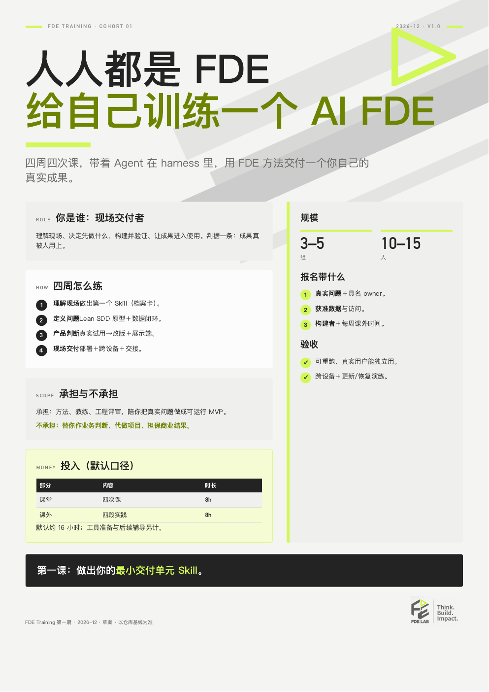
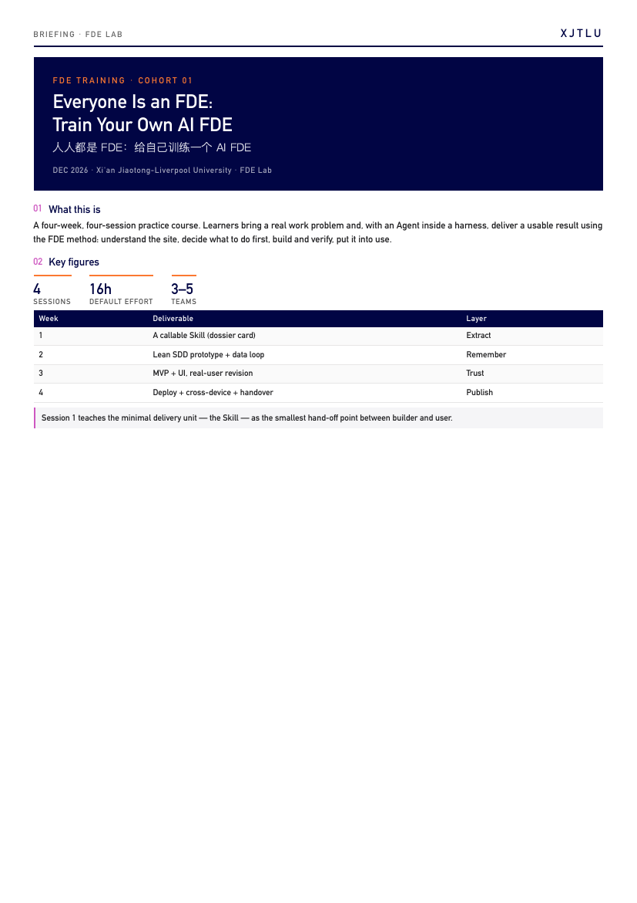

# XIPU Press (西浦印务)

[中文版](README.zh-CN.md)

## Why it exists
XIPU Press is XJTLU's in-house "print shop": it turns the two house brands into a design tool anyone can use. Teams and courses constantly need posters, briefings, boards and one-pagers; non-designers layout slowly and inconsistently, and raw AI output tends toward purple gradients, identical cards and non-compliant styling. XIPU Press freezes both brands' palette/type/components into a skill — feed text + images, get compliant, consistent, print-ready artifacts. Design capability becomes an installable, reusable tool.

Origin: XJTLU house style validated on real management documents (bilingual competition handbook); FDE Lab theme pixel-sampled page-by-page from the AI Leadership deck v1.0 (2026-10-27).

## Examples (examples/)
- FDE Lab poster: [HTML](examples/fde-lab-poster-sample.html) / [PDF](examples/fde-lab-poster-sample.pdf) / 
- XJTLU A4 briefing: [HTML](examples/xjtu-doc-sample.html) / [PDF](examples/xjtu-doc-sample.pdf) / 

A Codex skill that turns raw text and images into **print-ready designed artifacts**, in one of two house themes:

1. **XJTLU house style** — management documents (handbook, briefing, report, handover). A4, navy/orange/magenta. Spec: [references/design-system.md](references/design-system.md); template: [assets/xipu-doc-template.html](assets/xipu-doc-template.html).
2. **FDE Lab theme** — display artifacts (poster A2 portrait default, one-pager A4, share page, board). Off-white + ink + chartreuse-lime. Spec: [references/fde-lab-theme.md](references/fde-lab-theme.md) (**authoritative palette; do not eyeball colors**); template: [assets/fde-lab-poster-template.html](assets/fde-lab-poster-template.html); logo: [assets/fde-lab-logo.png](assets/fde-lab-logo.png).

> The FDE Lab theme is the FDE Training course visual rule (see `docs/visual-system.md` in the FDE_Training repo). Course slides use the same tokens but are built separately — this skill does not make slides.

## Install
**A · skill-installer (recommended):** ask Codex to "install the skill from XJTLU-AOA-TECH/xipu-press", or point skill-installer at that repo path.
**B · manual:** copy the whole `xipu-press/` folder to `~/.codex/skills/xipu-press/` and restart the session.

## Use
Ask Codex directly, e.g. "make an A4 briefing in XJTLU style", "make an FDE Lab poster, Chinese", "make a bilingual FDE Lab one-pager".
Workflow: read material → pick theme/format/language → read the matching reference → fill the template → render and visually verify → deliver HTML (+ PDF).

## Render & dependencies
- `python3 scripts/render_pdf.py <file.html> <out.pdf>` via local headless Chrome/Chromium/Edge (one must be installed). macOS, Windows and Linux install locations are searched automatically; on Windows, Edge ships with the OS.
- Posters also render a PNG preview for inspection (PyMuPDF optional).
- If Chrome SIGABRTs inside a sandbox, rerun outside it.

## Hard rules (summary)
- No gradients, no shadows in either theme; palette/fonts fixed by the references.
- XJTLU: no rounded corners, no icons, flat print.
- FDE Lab: card radius ≤6px; lime is fill/line only, emphasis on light uses olive, emphasis on the dark keybar uses lime; diagonal gray bars and the lime triangle appear only on covers/section pages/poster top band, never on body pages.
- External artifacts: audit open items first; no unconfirmed promises; footer states version/date/draft status.

## Not for
Slides, emails, official letters (management docs use XJTLU house style; slides use FDE tokens but are built separately).
