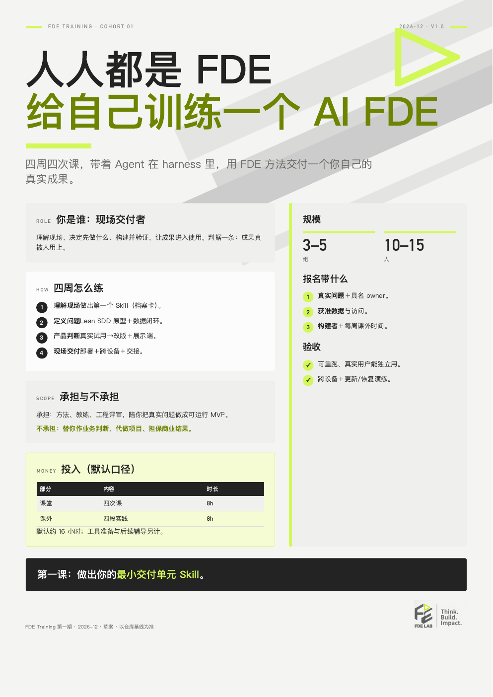
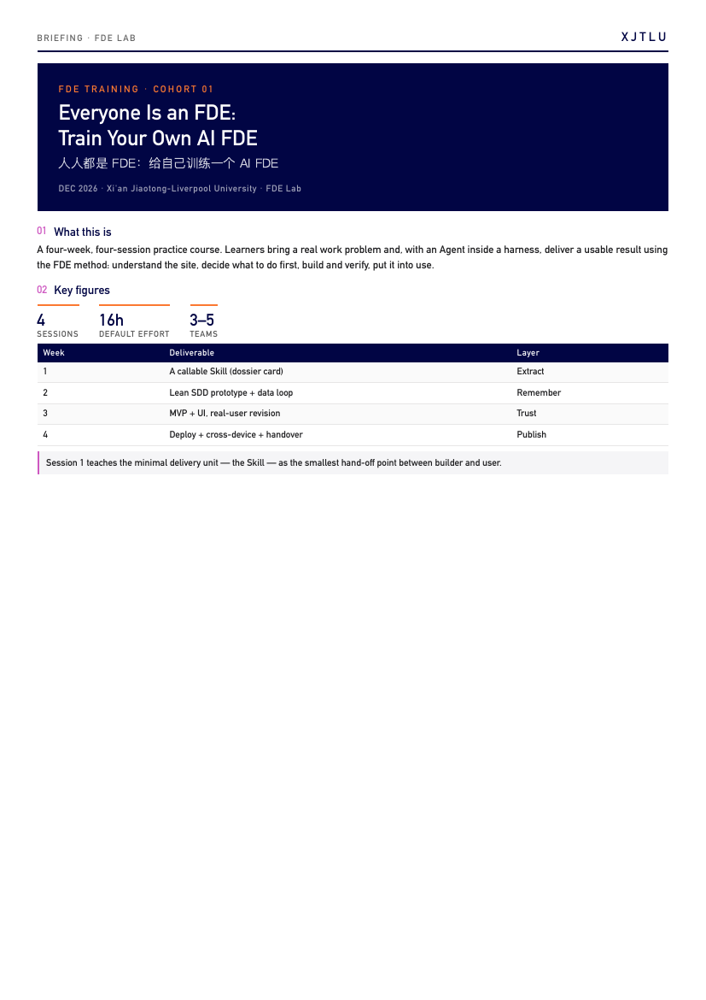

# XIPU Press · 西浦印务

[English](README.md)

## 为什么而生
「西浦印务」＝西浦的印务处：把社内品牌视觉变成人人可用的设计产出工具。团队与课程要持续产出海报、简报、展板、一页纸；非设计同事手工排版慢、视觉不统一，AI 直出又常是紫色渐变、雷同卡片、不合规。西浦印务把两套社内品牌的色板/字体/组件固化成 skill——丢文字＋图片，即产出合规、统一、可打印的设计件，把「设计能力」变成可安装、可复用的工具。

起源：XJTLU house style 在真实管理文件（双语竞赛手册）上验证；FDE Lab 主题从《AI 领导力》v1.0（2026-10-27）逐页像素取样。

## 示例（examples/）
- FDE Lab 海报：[fde-lab-poster-sample.html](examples/fde-lab-poster-sample.html)／[PDF](examples/fde-lab-poster-sample.pdf)／
- 西浦 A4 简报：[xjtu-doc-sample.html](examples/xjtu-doc-sample.html)／[PDF](examples/xjtu-doc-sample.pdf)／

把原始文字和图片变成**可直接打印的设计件**的 Codex skill。两套社内主题，二选一：

1. **XJTLU house style**——管理文件：手册、简报、报告、交接。A4，navy/orange/magenta。规范 [references/design-system.md](references/design-system.md)，模板 [assets/xipu-doc-template.html](assets/xipu-doc-template.html)。
2. **FDE Lab 主题**——展示物：海报（A2 竖版默认）、一页纸（A4）、分享页、展板。off-white＋ink＋荧光绿。规范 [references/fde-lab-theme.md](references/fde-lab-theme.md)（**色值权威，勿目测改色**），模板 [assets/fde-lab-poster-template.html](assets/fde-lab-poster-template.html)，logo [assets/fde-lab-logo.png](assets/fde-lab-logo.png)。

> FDE Lab 主题即 FDE Training 课程视觉统一规则，见 FDE_Training 仓库 `docs/visual-system.md`。课程 PPT 用同一套色值/字体，但 PPT 另行制作（本 skill 不做 slides）。

## 安装
**方式 A·skill-installer（推荐，仓库上 GitHub 后）**
对 Codex 说：「从 XJTLU-AOA-TECH/xipu-press 安装 skill」，或用 skill-installer 指定该仓库路径。

**方式 B·手动**
把整个 `xipu-press/` 文件夹拷到 `~/.codex/skills/xipu-press/`，重开会话即可。

## 使用
直接对 Codex 说需求，例如：
- 「用西浦风格把这份材料做成 A4 简报」
- 「做一张 FDE Lab 海报，主题……，中文」
- 「把这些内容做成 FDE Lab 一页纸，中英双语」

skill 会：读材料→定主题/版式/语言→读对应 reference→套模板→渲染并目检→交付 HTML（＋PDF）。

## 渲染与依赖
- `python3 scripts/render_pdf.py <file.html> <out.pdf>`，走本机 headless Chrome/Chromium/Edge（需已安装其一）。
- 海报另渲 PNG 预览目检（可用 PyMuPDF）。
- 沙箱内 Chrome 若 SIGABRT，改沙箱外重跑。

## 硬规则（摘要）
- 两主题均**无渐变、无阴影**；色板字体以 reference 为准。
- XJTLU：无圆角、无图标、平版打印。
- FDE Lab：卡片圆角≤6px；lime 只作填充/线条，浅底强调字用 olive，深色 keybar 强调字用 lime；斜灰条与 lime 三角只上封面/分节页/海报顶带，正文页不用。
- 对外件先审开口项，不写未确认承诺；页脚注版本/日期/草稿状态。

## 不适用
slides、邮件、公函（管理文件走 XJTLU house style；PPT 用 FDE 色值另行制作）。
